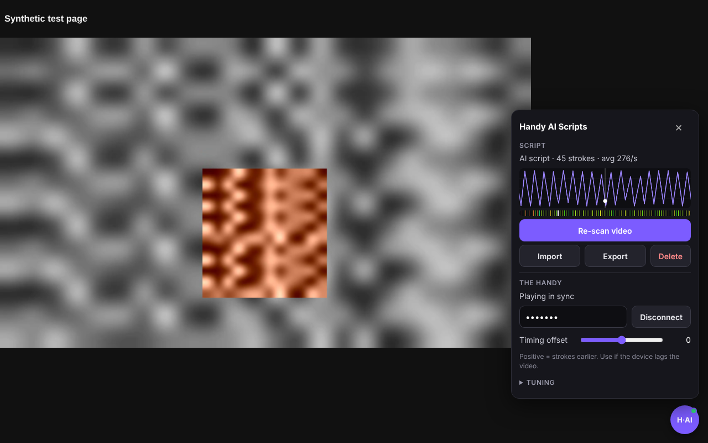
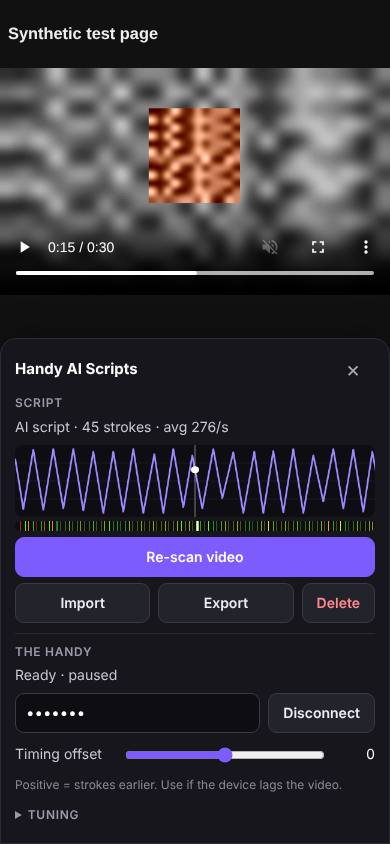

# Handy AI Scripts

A browser extension that makes stroker scripts for any video on Pornhub and plays them on **The Handy**, synced to the video. It works without a pre-made script: it watches the motion in the video and turns it into strokes. You can also import and export standard `.funscript` files.



## What it does

1. On any `pornhub.com/view_video.php` or `/embed/` page, an **H·AI** button appears in the bottom-right corner.
2. **Generate AI script** plays the video fast and muted (up to 8×), and analyses the motion frame by frame. A 10-minute video at 4× takes about 2.5 minutes.
3. The finished script is saved per video, so the next visit is instant. **Tuning** sliders (range, sensitivity, smoothing, speed limit, invert) apply immediately without re-scanning.
4. **Connect** your Handy with its connection key. The script is uploaded, and the device follows the video through play, pause, seek and buffering.

### How the "AI" works

There is no cloud model and no video leaves your browser. Only the finished script (a list of times and positions) is sent to The Handy's servers. The analysis is classic computer vision, running locally:

- **Block motion estimation.** Each frame is shrunk to 128 px wide and split into 8×8 blocks. Each block's movement since the last frame is found by matching, with sub-pixel refinement and a motion-continuity prior so repeating textures don't confuse it.
- **PCA over sliding 3-second windows.** This finds the strongest *coherent* back-and-forth movement in the shot. Regions moving in opposite directions (two bodies) reinforce each other instead of cancelling, and steady camera pans are removed.
- **Scene-cut detection.** Each shot is handled on its own.
- **Velocity → position → turning points.** An adaptive zig-zag filter finds the turning points. Local range normalisation keeps quiet passages usable while preserving relative stroke depth. A speed limit protects the device.

This works well when one dominant rhythmic motion is visible. It struggles with fast camera moves, very dark footage, close-ups with no texture, and scenes where the stroke isn't the main movement. In those cases try the Sensitivity slider, or import a hand-made funscript.

## Install

### Chrome, Edge, Brave, Opera (desktop)

1. Download or clone this repo (or `npm run package` and unzip `dist/handy-ai-scripts-*.zip`).
2. Open `chrome://extensions`, turn on **Developer mode**, click **Load unpacked**, choose this folder.
3. Click the extension icon, enter your **Handy connection key**, and press **Test connection**.

### Firefox (desktop and Android)

The same manifest works in Firefox 128+. On desktop, use `about:debugging` → *This Firefox* → *Load Temporary Add-on* → pick `manifest.json`. On Android, Firefox only installs add-ons that are signed by addons.mozilla.org, or come from a custom collection in Firefox Nightly.

### Phones: please read

**Google Chrome on Android and iOS does not run extensions at all.** No Chrome extension can work in mobile Chrome. To use this on a phone:

- **Android:** use **Firefox for Android**, or a Chromium-based browser that can install Chrome extensions (for example Edge, where your version allows it, or another extension-capable Chromium browser).
- **iPhone / iPad:** use the userscript build, `userscript/handy-ai-scripts.user.js`, with the free **Userscripts** app for Safari:
  1. Install **Userscripts** from the App Store and open it once to pick its scripts folder.
  2. Turn it on: Settings → Apps → Safari → Extensions → Userscripts → allow it, and set the websites option to *Allow*.
  3. In Safari, open the `.user.js` file (GitHub → file → *Raw*). Tap the extensions icon in the address bar → Userscripts → **Install**. Or save the file into the app's scripts folder in Files.
  4. Open a video, press play once, tap **H·AI**, enter your connection key, then **Generate AI script**.

  Run `npm run build:userscript` after changing the sources. `npm run test:userscript` tests it in Chromium with a fake userscript API.

The in-page panel is built for touch. It becomes a bottom sheet on narrow screens, with 40 px+ controls:



Phones scan more slowly. The scanner measures what the device can actually display and steps the speed down by itself.

## Using it

| Control | What it does |
|---|---|
| Generate AI script | Scans the video. Stop keeps what was scanned so far; press again to continue. |
| Import / Export | Load a `.funscript`, or save the current script (works with other players too). |
| Timing offset | Shifts the device earlier (+) or later (−) if it lags the video. |
| Bottom / Top | Stroke range in device units (0–100). |
| Sensitivity | Higher turns smaller movements into strokes. |
| Smoothing | Filters jitter before finding turning points. |
| Max speed | Device speed cap, in units per second. |
| Invert | Flip up/down if strokes feel reversed. |
| Scan speed | Maximum playback speed during the scan (it may go lower automatically). |

Notes:
- The Handy's script sync (HSSP) only follows 1× playback. At other speeds the device pauses.
- If a pre-roll ad plays in the main player, let it finish before scanning.
- If the player can't be read directly (cross-origin video), the extension scans a hidden copy that it loads with CORS. A `declarativeNetRequest` rule adds the CORS header for Pornhub's CDN (`phncdn.com`) for that copy only.

## The Handy API

All Handy endpoints are in `src/shared/handy.js` and use **API v2** with HSSP:

| Step | Call |
|---|---|
| Check online | `GET /connected` |
| Clock sync | `GET /servertime` (8 round trips, faster half averaged) |
| Upload | `POST https://www.handyfeeling.com/api/hosting/v2/upload` (multipart `file`, CSV) → `{url}` |
| Load | `PUT /mode {mode:1}`, then `PUT /hssp/setup {url}` |
| Play | `PUT /hssp/play {estimatedServerTime, startTime}` |
| Stop | `PUT /hssp/stop` |

All requests carry the `X-Connection-Key` header. The base URLs can be overridden under *Advanced* in the options page. If The Handy changes or retires v2, that file is the only place to update.

## Development

```
npm install          # Playwright, for the end-to-end test
npm test             # unit tests: motion analysis, funscript, Handy client
npm run test:e2e     # loads the extension in Chromium against a mocked page and a fake Handy API
npm run lint
npm run package      # dist/handy-ai-scripts-<version>.zip
```

The end-to-end test uses a synthetic video: a textured patch moving up and down at 1.5 Hz. It checks:

- The scanner finds about 45 strokes within 30 s, at the right phase.
- The script is uploaded and set up on the Handy.
- Play, seek and pause send the right HSSP calls.
- The cross-origin fallback works.
- The mobile layout renders.

Screenshots go to `test/e2e/out/`.

### Layout

```
manifest.json            MV3, works in Chrome (service worker) and Firefox (event page)
rules/cdn-cors.json      CORS header for the hidden-copy fallback
src/background.js        All network calls to The Handy, upload cache, clock offset
src/shared/motion.js     Block matching, PCA analysis, script generation
src/shared/funscript.js  Parse / serialise / CSV / speed limit
src/shared/handy.js      Handy REST client
src/content/scanner.js   Plays the video fast and samples frames
src/content/panel.js     In-page UI (shadow DOM)
src/content/main.js      Wires everything together, video ↔ Handy sync
src/options/             Toolbar popup / options page
```

## Privacy

Video frames are analysed in your browser and never uploaded. Scripts and settings live in the extension's local storage. When you connect a Handy, the generated script (times and positions only) is uploaded to The Handy's script hosting, as every HSSP player does. Your connection key is sent only to `handyfeeling.com`.

Adults only. Use this only with content and devices you're allowed to use.
